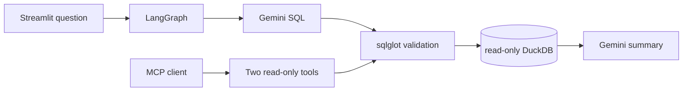

# Agentic Data Analyst

This project is a small, production-minded data analyst for real New York City yellow taxi records. It turns natural-language questions into read-only DuckDB queries with Gemini, validates every query before execution, and shows the answer, SQL, table, chart, coverage, and diagnostics in Streamlit. The same guarded data layer is available through two MCP tools, with offline tests and a hand-authored result-equivalence evaluation set.

## What is included

- A deterministic 100,000-row sample from the official January 2024 Yellow Taxi Parquet file
- A five-stage LangGraph flow: understand, generate SQL, validate, execute, summarize
- SQL parsing with `sqlglot`, allowed tables, blocked operations and file readers, read-only DuckDB access, and a result cap
- Streamlit, Plotly, structured logs, local Prometheus metrics, and optional Langfuse dependencies
- A read-only MCP server, 24 evaluation questions, pytest coverage, Ruff, and GitHub Actions



## Data and limitations

The download script uses the official NYC TLC-hosted [January 2024 Yellow Taxi Trip Records](https://d37ci6vzurychx.cloudfront.net/trip-data/yellow_tripdata_2024-01.parquet) and [Taxi Zone Lookup](https://d37ci6vzurychx.cloudfront.net/misc/taxi_zone_lookup.csv), linked from the [TLC trip record page](https://www.nyc.gov/site/tlc/about/tlc-trip-record-data.page). The links were selected on November 6, 2026. By default the database contains the first 100,000 records whose pickup time falls within January 2024, ordered by pickup timestamp. This filter excludes timestamp anomalies outside the published month. Results describe only that loaded sample and its displayed date range. Raw data and the database stay outside Git.

Important fields include pickup and drop-off timestamps, distance, pickup and drop-off zone IDs, payment type, fare, tip, total amount, and pickup borough and zone from the official lookup. TLC records can contain data-quality anomalies. This project does not silently clean or replace them.

## Setup

Use Python 3.11 or 3.12. Python 3.13 may work but is not the CI target.

Windows PowerShell:

```powershell
py -3.11 -m venv .venv
.venv\Scripts\Activate.ps1
python -m pip install -e ".[dev]"
Copy-Item .env.example .env
python scripts\download_data.py --row-limit 100000
streamlit run app.py
```

Linux or macOS:

```bash
python3.11 -m venv .venv
source .venv/bin/activate
python -m pip install -e '.[dev]'
cp .env.example .env
python scripts/download_data.py --row-limit 100000
streamlit run app.py
```

Set `GEMINI_API_KEY` in `.env`. The default model is `gemini-2.5-flash-lite` and can be changed with `GEMINI_MODEL`. Never commit `.env`. Network failures stop with an error and never trigger synthetic fallback data.

Try questions such as:

- How many trips occurred per day?
- What were the busiest pickup hours?
- What was the average fare by pickup borough?
- How did tip percentage vary by payment type?
- Compare weekday and weekend demand.

Outputs are shaped as a short grounded answer, a table, the exact SQL, and, when the result fits, a bar or line chart. No example metric is printed here because it should be computed from your local sample.

## MCP, metrics, and tracing

Start the MCP server over standard input and output with `taxi-mcp`. It exposes `dataset_description` and `run_readonly_query`. MCP is a separately runnable integration path. The Streamlit LangGraph flow calls the shared Python functions directly and does not claim to use an MCP client.

Metrics are registered with `prometheus-client`. To expose them only on localhost, run:

```powershell
python -c "from data_analyst.config import settings; from data_analyst.telemetry import start_metrics; import time; start_metrics(settings.metrics_port); time.sleep(999999)"
```

Then open `http://127.0.0.1:8001/metrics`. Logs are JSON lines with request ID, stage, latency, outcome, and error type. They do not include prompts, rows, keys, or personal data.

Optional Langfuse variables are documented in `.env.example`. Install its SDK with `python -m pip install -e ".[tracing]"`. Credentials are optional and no trace is claimed until the integration is configured and verified.

## Tests and evaluation

Run deterministic checks without an API key or data download:

```powershell
ruff check .
ruff format --check .
pytest
```

After loading data and explicitly configuring a Gemini key, run:

```powershell
taxi-eval --questions eval/questions.json --output eval/results/latest.json
```

The 24 questions are hand-authored for this project, not an official NYC benchmark. Answer cases compare results with reference-query results using numeric tolerance, not SQL strings. Refusal cases test safe handling. The report contains execution accuracy and p50/p95 latency. It does not estimate cost because pricing is not pinned. Evaluation makes API calls only when you invoke it with a configured key.

## Security design

Only one parsed `SELECT` or `WITH ... SELECT` statement is accepted. Tables are allowlisted, DuckDB file and scan functions are blocked, write and administrative AST nodes are rejected, the connection is read-only, and results are capped. The model cannot run Python, shell commands, or external tools. This is a narrow application boundary, not a general SQL sandbox, and DuckDB should still run with ordinary operating-system permissions and no secrets in its working directory.

## Troubleshooting

`No local dataset found` means the download script has not completed. A Gemini authentication error usually means `GEMINI_API_KEY` is missing or invalid. Model-not-found errors can be fixed with a model available to your Google account through `GEMINI_MODEL`. If a generated query is rejected, ask a more focused analytical question that uses the displayed schema.

## Status

Implemented: real-data download and validation, DuckDB load, guarded queries, LangGraph workflow, Streamlit UI, MCP server, structured logging, Prometheus measurements, evaluation runner, offline tests, and CI. Optional and environment-dependent: Gemini calls, Langfuse tracing, larger samples, and deployment. No benchmark score or production trace is claimed until produced in the target environment.

Licensed under the MIT License.
